# DA3-to-Gaussians

**COLMAP 없이 3D Gaussian Splatting 학습하기: Depth Anything 3 + gsplat**

3DGS 학습에는 보통 COLMAP SfM이 만든 카메라 파라미터(K, R|t)와 초기 sparse point가 필요합니다. 이 프로젝트는 그 전처리를 3D foundation model인 [Depth Anything 3 (DA3)](https://github.com/ByteDance-Seed/Depth-Anything-3)의 feed-forward 추론 한 번으로 대체하고, 그 출력을 COLMAP 바이너리 포맷으로 변환해 [gsplat](https://github.com/nerfstudio-project/gsplat)에 그대로 넣는 파이프라인을 실험한 기록입니다. gsplat 코드는 수정하지 않았습니다.

```
기존   images ─▶ COLMAP (feature · match · SfM) ─▶ K, R|t, sparse points ─▶ gsplat (30k step)
제안   images ─▶ DA3 (feed-forward 1회)          ─▶ K, R|t, depth → points ─▶ COLMAP 포맷(.bin) ─▶ gsplat (30k step)
```

| 장면 | 이미지 수 | COLMAP → gsplat | **DA3 → gsplat (COLMAP-free)** | 차이 |
|---|---:|---:|---:|---:|
| Truck (Tanks&Temples) | 251 | 25.22 dB | **20.28 dB** | −4.94 dB |
| Train (Tanks&Temples) | 301 | 21.94 dB | **18.30 dB** | −3.64 dB |

test PSNR, 30k step, `test_every=8` (Truck 32장, Train 38장 held-out).

정답 카메라가 있는 Statue 장면에서는 DA3 입력으로 학습한 3DGS가 COLMAP보다 테스트 PSNR이 1.5–3.2 dB 높았습니다. 포즈는 COLMAP이 더 정확하지만, DA3 초기 포인트가 배경까지 덮기 때문으로 보입니다. → [Statue 결과](#statue-colmap-vs-da3-디코더-방식-vs-da3-ray-방식)

---

## 데모 영상

두 모델 모두 같은 gsplat 설정(`default` strategy, 30k step)으로 학습했습니다. 왼쪽은 COLMAP 입력, 오른쪽은 DA3 출력만으로 학습한 결과입니다. 궤적은 각 모델의 카메라 좌표계에서 생성했기 때문에 두 영상의 프레임이 정확히 같은 시점은 아닙니다.

**Truck** · 왼쪽 COLMAP (PSNR 25.22), 오른쪽 DA3 COLMAP-free (PSNR 20.28)

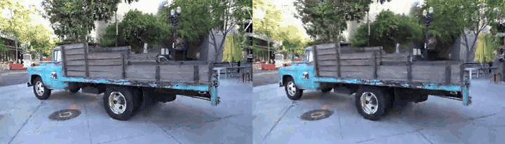

**Train** · 왼쪽 COLMAP (PSNR 21.94), 오른쪽 DA3 COLMAP-free (PSNR 18.30)

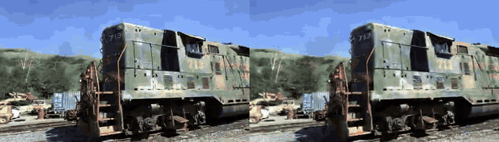

원본 화질 영상: [Truck](assets/videos/truck_colmap_vs_da3.mp4) · [Train](assets/videos/train_colmap_vs_da3.mp4)

---

## 같은 시점에서 본 각 설정의 결과

gsplat의 test view #5를 각 설정으로 렌더링한 결과입니다(30k step). 설정 이름 아래의 `K / 포즈 / 포인트`는 각 입력을 COLMAP과 DA3 중 어디서 가져왔는지 나타냅니다.

### Truck

| 정답 (GT) | ① COLMAP 기준선 |
|:---:|:---:|
| 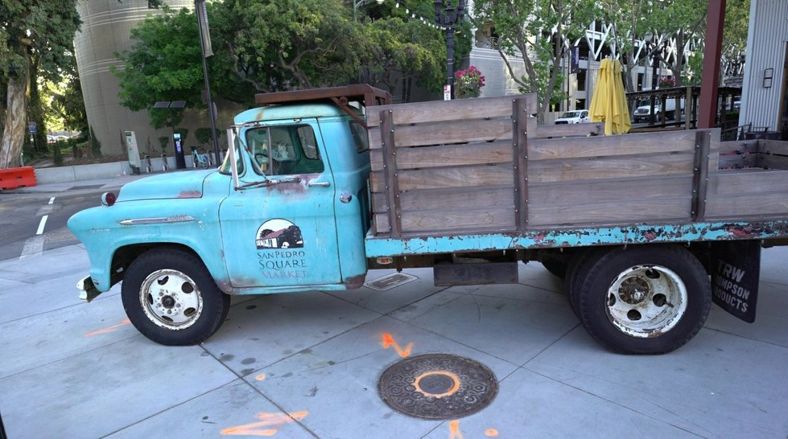 | 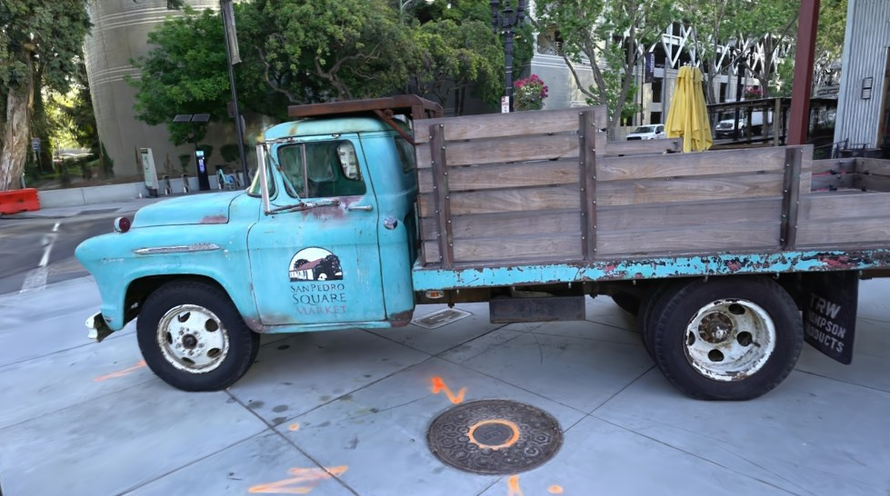 |
| test view #5 | K: COLMAP / 포즈: COLMAP / 포인트: COLMAP<br>**PSNR 25.22 · SSIM 0.879 · LPIPS 0.098** |

| ② DA3 포즈 | ③ DA3 포즈 + DA3 포인트 (conf 필터) |
|:---:|:---:|
| 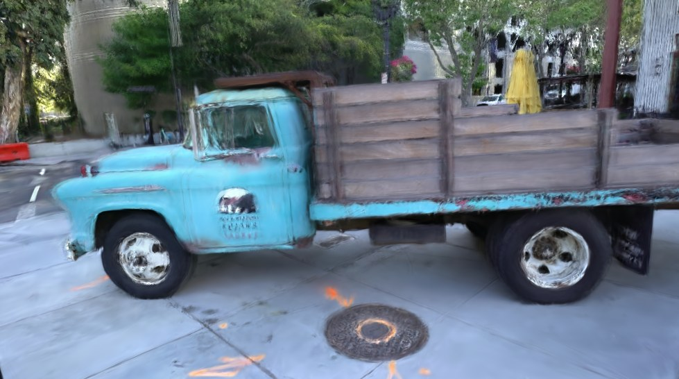 | 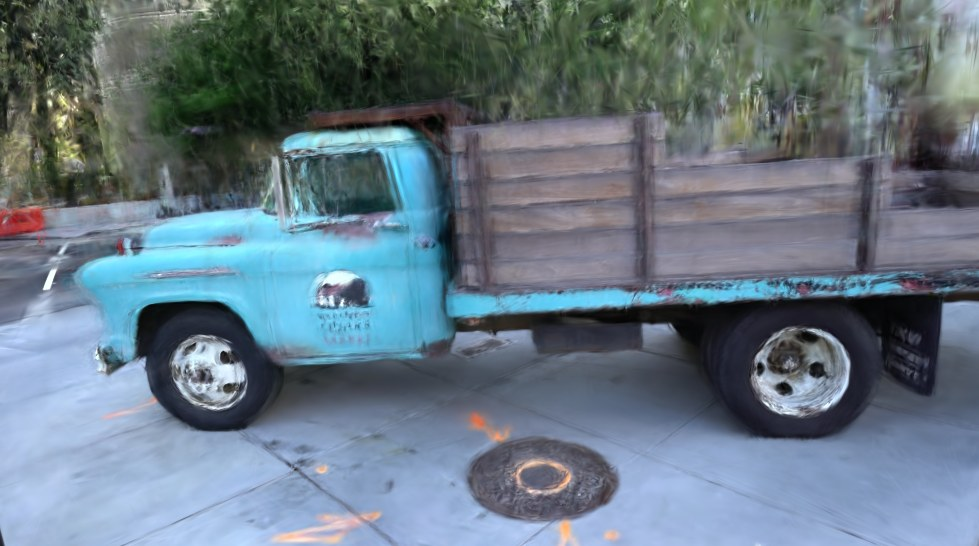 |
| K: COLMAP / 포즈: **DA3** / 포인트: COLMAP<br>**PSNR 21.05 · SSIM 0.688 · LPIPS 0.205** | K: COLMAP / 포즈: **DA3** / 포인트: **DA3** (confidence 필터)<br>**PSNR 17.19 · SSIM 0.592 · LPIPS 0.345** |

| ④ DA3 포즈 + DA3 포인트 (필터 없음) | ⑤ COLMAP-free (DA3 전체) |
|:---:|:---:|
| 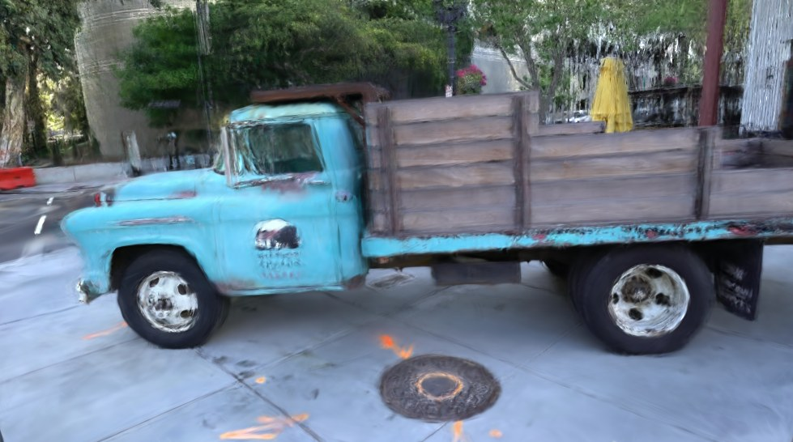 | 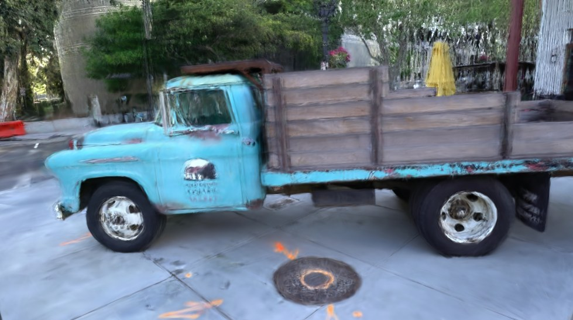 |
| K: COLMAP / 포즈: **DA3** / 포인트: **DA3**<br>**PSNR 20.25 · SSIM 0.662 · LPIPS 0.239** | K: **DA3** / 포즈: **DA3** / 포인트: **DA3**<br>**PSNR 20.28 · SSIM 0.662 · LPIPS 0.241** |

### Train

| 정답 (GT) | COLMAP 기준선 | COLMAP-free (DA3 전체) |
|:---:|:---:|:---:|
| 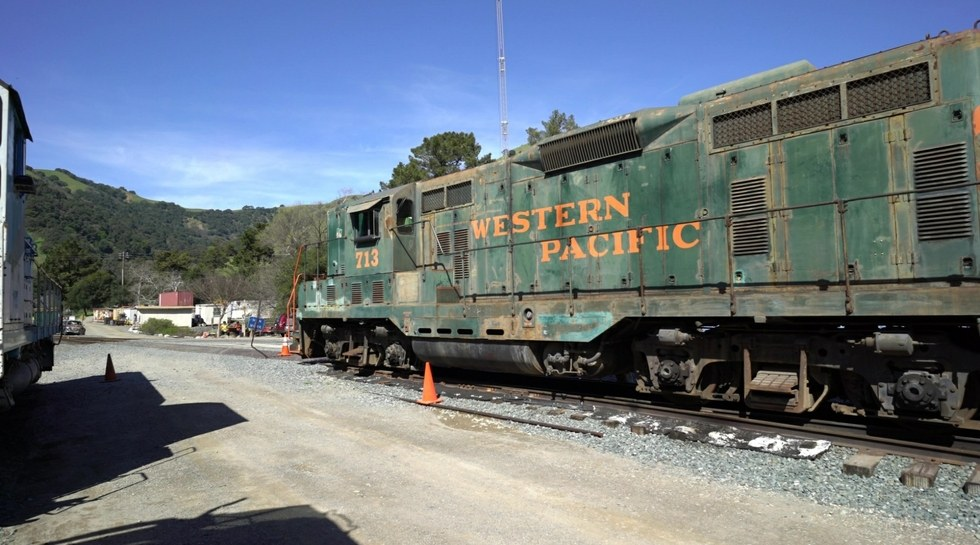 | 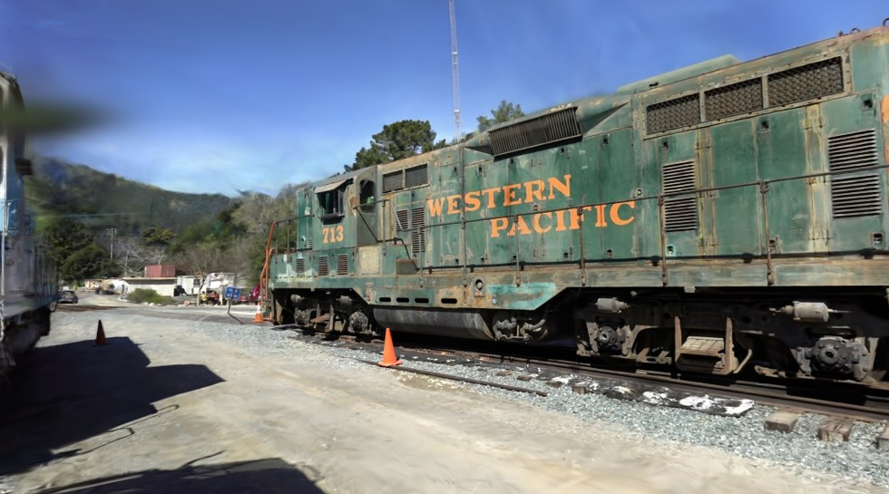 | 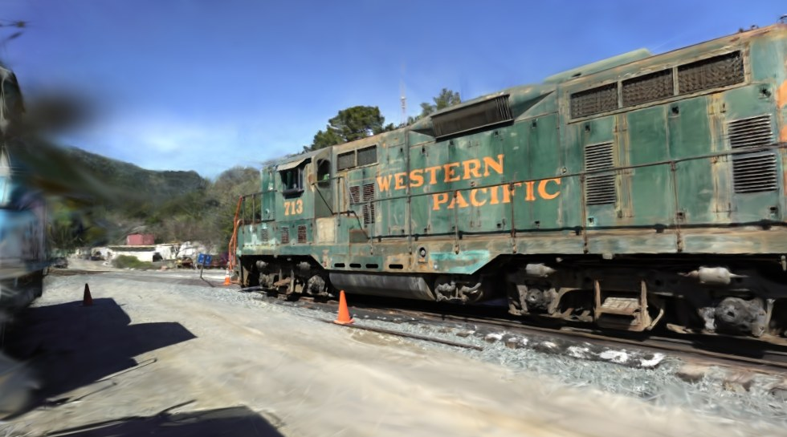 |
| test view #5 | **PSNR 21.94 · SSIM 0.811 · LPIPS 0.162** | **PSNR 18.30 · SSIM 0.584 · LPIPS 0.331** |

수치는 각 설정의 test 전체 평균이며, 이미지 한 장에 대한 값이 아닙니다.

---

## 정량 결과 (Truck ablation)

| # | 설정 | K | 포즈 | 포인트 | PSNR ↑ | SSIM ↑ | LPIPS ↓ | Gaussians | PSNR @7k |
|---|---|---|---|---|---:|---:|---:|---:|---:|
| ① | COLMAP 기준선 (`truck_single`) | COLMAP | COLMAP | COLMAP | **25.22** | **0.879** | **0.098** | 2.55M | 23.76 |
| ② | DA3 포즈 (`truck_da3pose`) | COLMAP | DA3 | COLMAP | 21.05 | 0.688 | 0.205 | 2.18M | 20.49 |
| ③ | DA3 포즈 + 포인트, conf 필터 (`truck_da3full_136k`) | COLMAP | DA3 | DA3 | 17.19 | 0.592 | 0.345 | 0.71M | 17.03 |
| ④ | DA3 포즈 + 포인트 (`truck_da3nofilter_136k`) | COLMAP | DA3 | DA3 | 20.25 | 0.662 | 0.239 | 1.99M | 19.64 |
| ⑤ | **COLMAP-free** (`truck_colmapfree_136k`) | DA3 | DA3 | DA3 | 20.28 | 0.662 | 0.241 | 1.94M | 19.71 |

- 품질 손실의 대부분은 **포즈 교체(① → ②, −4.17 dB)** 에서 생깁니다. intrinsic과 초기 포인트까지 DA3로 바꿔도(② → ⑤) 추가 손실은 0.77 dB입니다.
- ④와 ⑤가 거의 같아서, intrinsic을 DA3 예측값으로 바꿔도 손실은 거의 없었습니다.
- 초기 포인트는 confidence 필터를 쓰지 않은 쪽(④)이 필터를 쓴 쪽(③)보다 3.06 dB 높았습니다. Gaussian 수도 0.71M에서 1.99M으로 늘었습니다. 원인은 아직 분석하지 않았습니다.
- DA3 포인트 수는 비교를 위해 COLMAP sparse point 수와 맞췄습니다(Truck 136,029개, Train 182,686개).
- 2-GPU로 학습한 COLMAP 기준선(`truck`)은 PSNR 23.73으로, 단일 GPU 결과(①)를 기준으로 썼습니다.

원본 수치: [`results/gsplat/*/val_step29999.json`](results/gsplat)

---

## Statue: COLMAP vs DA3 디코더 방식 vs DA3 Ray 방식

정답 카메라가 있는 합성 장면 Statue(1920×1080, 100장)에서, 학습 이미지 수(12 · 24 · 50장)마다 세 가지 입력으로 gsplat을 학습했습니다. 학습에 쓰지 않은 나머지 이미지(88 · 76 · 50장)가 모두 테스트 시점입니다.

| 입력 | 카메라 내부 파라미터 | 포즈 | 초기 포인트 |
|---|---|---|---|
| COLMAP | COLMAP | COLMAP | COLMAP sparse points |
| DA3 디코더 방식 | DA3 | DA3 디코더 | DA3 depth를 펼친 점에서 균일 샘플 |
| DA3 Ray 방식 | DA3 | DA3 Ray | DA3 depth를 펼친 점에서 균일 샘플 |

- 초기 포인트 수는 같은 N의 COLMAP 포인트 수와 맞췄습니다(12장 1,151개 · 24장 6,477개 · 50장 15,081개).
- 학습 설정은 모두 같습니다: gsplat `default`, 30k step, `data_factor 1`, `pose_opt` 꺼짐.
- **테스트 시점의 포즈**: 각 방법은 자기만의 좌표계를 가지므로, 정답 포즈를 학습 카메라로 구한 Sim(3)로 각 방법의 좌표계에 옮겨서 렌더링했습니다(아래 표의 "정렬만").
- **테스트 시점 포즈 보정**: 이 정렬에는 학습 포즈의 오차가 그대로 남습니다. 그래서 pose-free 3DGS 논문(예: InstantSplat)처럼 Gaussian은 고정하고 각 테스트 카메라의 포즈만 300회 최적화한 뒤 다시 평가했습니다(아래 표의 "포즈 보정 후"). 세 방법 모두 똑같이 적용했습니다.

### 렌더링 영상 (24장 · 50장)

왼쪽부터 **COLMAP · DA3 디코더 방식 · DA3 Ray 방식**. 궤적은 각 모델 좌표계의 카메라 위치로 gsplat이 만든 것이라, 세 영상의 프레임이 정확히 같은 시점은 아닙니다.

**24장**

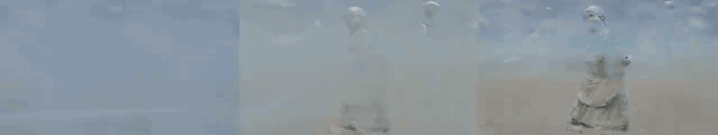

**50장**


### 같은 시점에서 본 결과

모든 N에서 테스트 시점인 #0026, #0051을 포즈 보정 후 렌더링한 결과입니다.

**테스트 시점 #0026**

| 이미지 수 | 정답 (GT) | COLMAP | DA3 디코더 방식 | DA3 Ray 방식 |
|---|:---:|:---:|:---:|:---:|
| 12장 | 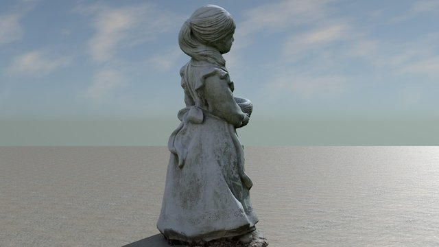 | 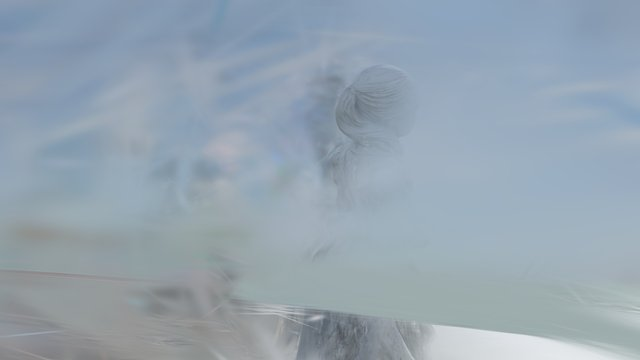 | 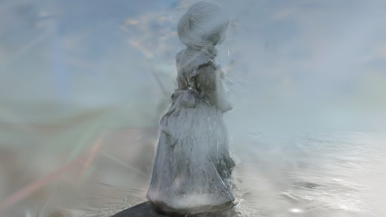 | 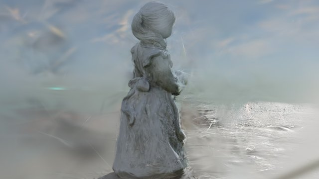 |
| 24장 |  | 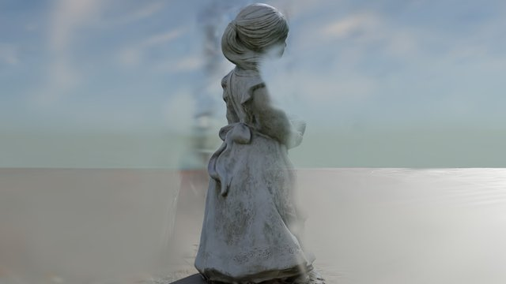 | 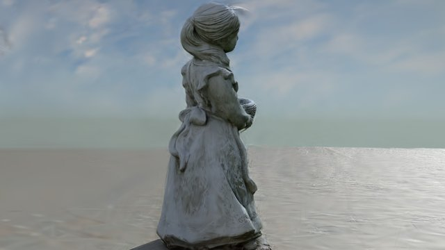 |  |
| 50장 |  | 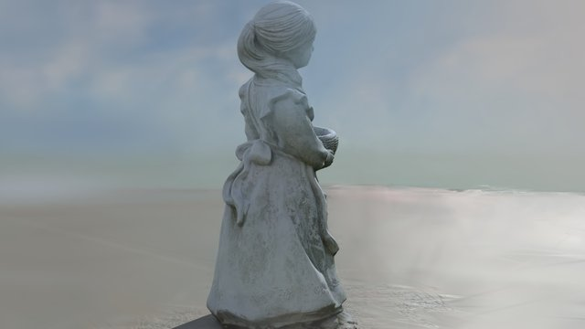 | 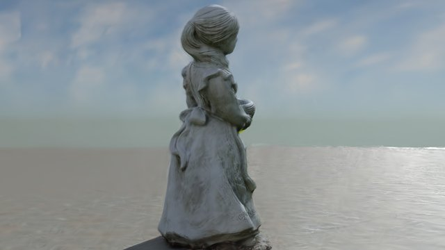 | 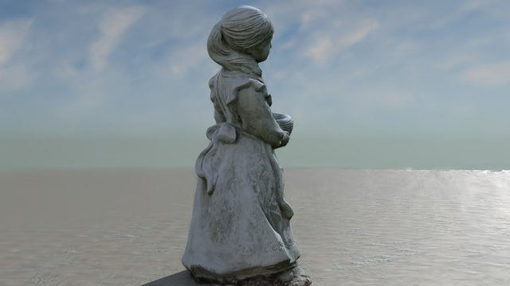 |

**테스트 시점 #0051**

| 이미지 수 | 정답 (GT) | COLMAP | DA3 디코더 방식 | DA3 Ray 방식 |
|---|:---:|:---:|:---:|:---:|
| 12장 | 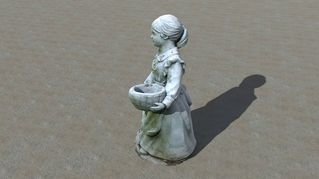 | 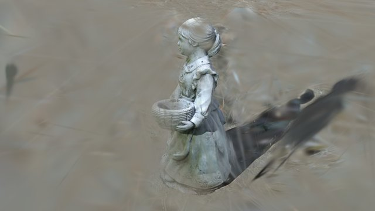 | 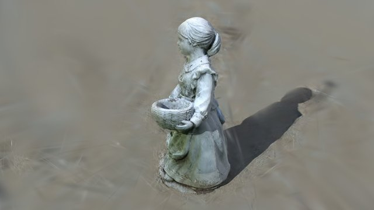 |  |
| 24장 |  | 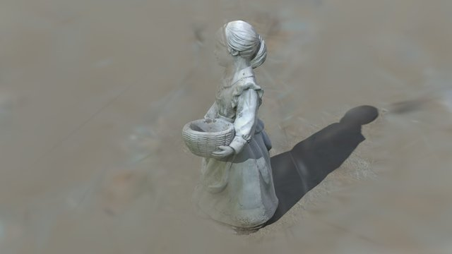 |  |  |
| 50장 |  | 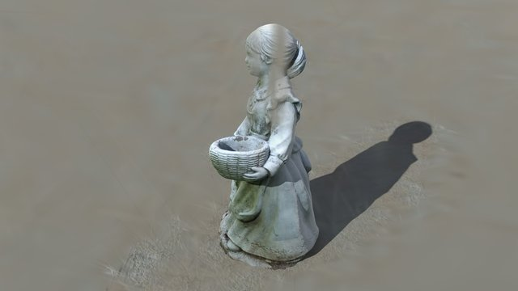 | 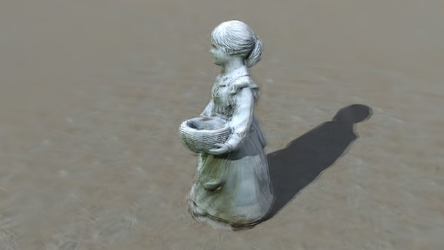 | 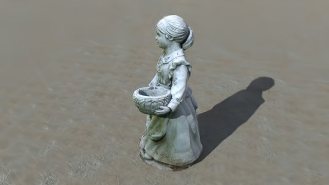 |

### 정량 결과

테스트 시점 전체 평균입니다. 굵은 글씨는 같은 N에서 가장 좋은 값입니다.

| 이미지 수 | 방법 | 회전 오차 (°) | PSNR ↑ 정렬만 | SSIM ↑ 정렬만 | LPIPS ↓ 정렬만 | **PSNR ↑ 포즈 보정 후** | **SSIM ↑ 포즈 보정 후** | **LPIPS ↓ 포즈 보정 후** | Gaussians |
|---|---|---:|---:|---:|---:|---:|---:|---:|---:|
| 12 | COLMAP | **0.05** | 20.05 | **0.734** | 0.585 | 20.89 | **0.730** | 0.580 | 434K |
| 12 | DA3 디코더 | 0.36 | 20.81 | 0.718 | 0.578 | 22.05 | 0.727 | 0.570 | 112K |
| 12 | DA3 Ray | 0.48 | **20.88** | 0.717 | **0.566** | **22.37** | 0.728 | **0.557** | 231K |
| 24 | COLMAP | **0.03** | 20.83 | **0.751** | 0.572 | 22.12 | 0.743 | 0.563 | 168K |
| 24 | DA3 디코더 | 0.36 | **22.76** | 0.729 | 0.560 | 24.81 | 0.745 | 0.539 | 109K |
| 24 | DA3 Ray | 0.39 | 22.66 | 0.725 | **0.551** | **25.27** | **0.754** | **0.523** | 133K |
| 50 | COLMAP | **0.04** | 24.44 | **0.773** | 0.526 | 25.45 | 0.768 | 0.502 | 148K |
| 50 | DA3 디코더 | 0.29 | **24.61** | 0.735 | 0.519 | 27.93 | 0.762 | 0.502 | 103K |
| 50 | DA3 Ray | 0.33 | 24.05 | 0.729 | **0.506** | **28.43** | **0.775** | **0.470** | 154K |

### 해석

- **포즈는 COLMAP이 더 정확하지만, 렌더링 품질은 DA3 입력이 같거나 더 좋았습니다.** 포즈 보정 후 PSNR은 DA3 Ray 방식이 COLMAP보다 1.5 dB(12장), 3.2 dB(24장), 3.0 dB(50장) 높습니다.
- **차이의 주된 원인은 초기 포인트의 위치로 보입니다.** 포인트 수는 같아도 COLMAP 포인트는 조각상 주변에 몰려 있고(카메라 반경의 절반 이내 86–91%, 카메라 원 밖 0%), DA3 포인트는 바다·하늘 같은 배경까지 퍼져 있습니다(카메라 원 밖 약 48%). 12장·50장 데이터로 측정한 값입니다. 질감이 거의 없는 바다와 하늘에서는 COLMAP이 특징점을 찾지 못하기 때문입니다. 위 비교 이미지에서도 COLMAP 결과는 배경이 흐릿하게 뭉개지고, 12장에서는 조각상까지 무너집니다.
- **포즈 오차의 영향은 "정렬만"과 "포즈 보정 후"의 차이에서 보입니다.** 포즈 보정으로 오르는 폭이 COLMAP은 0.8–1.3 dB, DA3는 1.2–4.4 dB로, 오차가 더 큰 DA3에서 더 큽니다. 정렬만 했을 때 SSIM이 COLMAP에서 가장 높은 것도 같은 이유로 보입니다.
- **DA3 디코더 방식과 Ray 방식은 비슷합니다.** 포즈 보정 후에는 Ray 방식이 세 경우 모두 0.3–0.5 dB 높았습니다.
- 조각상 하나에 넓은 배경이 있는 장면이라 LPIPS가 전체적으로 높습니다(0.47–0.59). 이 결론이 다른 장면에서도 성립하는지는 확인하지 않았습니다.

원본 수치: [`results/statue_3dgs/`](results/statue_3dgs) (`val_step29999.json`: gsplat 자체 평가, `eval_tto.json`: 정렬만 / 포즈 보정 후 결과와 시점별 값, `pose_eval.json`: 학습 카메라 포즈 오차)

---

## 실험 과정

### 1. 환경 구축과 기준선 (7/22–23)
- Docker 컨테이너 두 개(`gsplat`, `da3`)를 구성하고, Truck에서 COLMAP 입력으로 gsplat을 학습해 기준선을 잡았습니다.
- DA3 공식 예제를 돌려 출력(extrinsic, intrinsic, depth, conf, Gaussian)의 구조와 좌표계를 확인했습니다. → `scripts/01_da3_feedforward/control.py`, `diag.py`, `sweep.py`, `sanity_check*.py`

### 2. DA3 feed-forward 3DGS를 그대로 쓰기 (7/29–31)
DA3의 GS head가 바로 내놓는 Gaussian을 pose-free로 렌더링해 held-out 뷰에서 평가했습니다. 입력 뷰를 2장에서 128장까지 늘려도 PSNR이 12 dB 근처에서 멈췄고, VRAM은 뷰 수에 비례해 늘어 180장에서 OOM이 났습니다(RTX 5090 32GB). 그대로는 장면 단위 복원에 쓰기 어렵다고 보고, DA3를 **학습 기반 gsplat의 입력 생성기**로 쓰는 방향으로 바꿨습니다.

| 입력 뷰 | 2 | 8 | 24 | 48 | 128 | 180 |
|---|---:|---:|---:|---:|---:|---:|
| PSNR (dB) | 10.05 | 10.19 | 11.72 | 11.94 | 11.66 | OOM |
| peak VRAM (GB) | 7.4 | 9.3 | 10.6 | 14.1 | 25.8 | – |

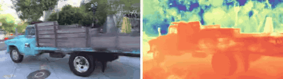

→ `scripts/01_da3_feedforward/view_scaling_eval.py`, `eval_posefree.py`, `posefree_24.py`, 결과 [`results/da3_feedforward/`](results/da3_feedforward)

### 3. 포즈만 DA3로 교체 (7/31)
Truck 251장 전체를 DA3에 한 번에 넣어 포즈를 예측하고, Umeyama Sim(3)로 COLMAP 좌표계에 정렬한 뒤 `images.bin`만 교체했습니다. → `predict_all_poses.py`, `make_da3_colmap.py` (설정 ②)

### 4. 초기 포인트도 DA3 depth로 교체 (8/1–8/6)
DA3 depth를 뷰별로 unprojection해 COLMAP과 같은 개수의 포인트를 만들어 `points3D.bin`을 교체했습니다. → `extract_da3_geometry.py`, `make_da3_points.py` (설정 ③), `make_da3_points_nofilter.py` (설정 ④)

### 5. 완전한 COLMAP-free 파이프라인 (8/6–8/7)
intrinsic까지 DA3 예측값을 원본 해상도로 환산해 쓰고, Sim(3) 정렬 없이 DA3 좌표계 그대로 `cameras.bin`, `images.bin`, `points3D.bin`을 직접 작성했습니다. Train 장면에서도 같은 방식으로 재현했습니다. → `make_da3_full_colmapfree.py`, `make_da3_full_colmapfree_train.py` (설정 ⑤)

### 6. 포즈 정확도와 속도 비교, Statue (8/27–28, 10/30 수정)
정답(GT) 카메라가 있는 합성 장면 Statue에서 12 · 24 · 50장으로 COLMAP(pycolmap)과 DA3의 두 가지 포즈 추정 방식을 비교했습니다. DA3는 카메라 디코더로 포즈를 바로 내는 방식(이하 **디코더 방식**)과, 픽셀별 광선(ray) 예측에서 포즈를 계산하는 방식(`use_ray_pose`, 이하 **Ray 방식**)이 있습니다. 정답과는 Umeyama Sim(3)로 정렬했습니다.

| 방법 | 뷰 | 시간 (s) | 위치 RMSE (장면 반경 대비 %) | 회전 오차 평균 (°) |
|---|---:|---:|---:|---:|
| COLMAP | 12 | 2.80 | **0.08** | **0.05** |
| DA3 디코더 | 12 | 1.70 | 0.87 | 0.36 |
| DA3 Ray | 12 | **1.20** | 1.20 | 0.48 |
| COLMAP | 24 | 7.35 | **0.06** | **0.03** |
| DA3 디코더 | 24 | **1.53** | 0.55 | 0.36 |
| DA3 Ray | 24 | 1.74 | 0.47 | 0.40 |
| COLMAP | 50 | 27.52 | **0.09** | **0.04** |
| DA3 디코더 | 50 | **2.73** | 0.49 | 0.29 |
| DA3 Ray | 50 | 3.04 | 0.38 | 0.33 |

- DA3는 50장에서도 3초 안에 끝나 COLMAP보다 약 10배 빠르고, 포즈 오차는 COLMAP보다 약 10배 큽니다(회전 0.3–0.5°). 디코더 방식과 Ray 방식은 비슷한 수준입니다.
- **처음 기록했던 Ray 방식의 회전 오차 171°는 평가 코드의 버그였습니다.** DA3의 `Prediction.extrinsics`는 두 방식 모두 월드→카메라(W2C) 행렬인데, `pose_eval.py`가 Ray 방식 결과만 카메라→월드(C2W)로 읽고 있었습니다. 두 방식의 원본 행렬끼리 직접 비교하면 회전 차이가 0.35–0.47°로 거의 같습니다. 수정한 코드: [`scripts/03_pose_eval/pose_eval.py`](scripts/03_pose_eval/pose_eval.py)

→ `scripts/03_pose_eval/`, 결과 [`results/statue_pose/`](results/statue_pose)

### 7. 포즈 출처별 3DGS 학습 비교, Statue (10/30)
6번에서 비교한 세 가지 포즈로 실제 3DGS를 학습하고 학습에 쓰지 않은 시점에서 렌더링 품질을 비교했습니다. 결과는 [아래 Statue 절](#statue-colmap-vs-da3-디코더-방식-vs-da3-ray-방식)에 정리했습니다.

---

## 환경

| 항목 | 내용 |
|---|---|
| GPU | NVIDIA RTX 5090 32GB × 2 (학습은 단일 GPU) |
| Docker 이미지 | `pytorch/pytorch:2.11.0-cuda12.8-cudnn9-devel` (두 컨테이너 공통, `--gpus all --shm-size 16g`) |
| gsplat | [nerfstudio-project/gsplat](https://github.com/nerfstudio-project/gsplat) @ `bf302ef5`, 수정 없음 |
| Depth Anything 3 | [ByteDance-Seed/Depth-Anything-3](https://github.com/ByteDance-Seed/Depth-Anything-3) @ `3fe327a` + [`patches/depth-anything-3.patch`](patches/depth-anything-3.patch) |
| DA3 모델 | `DA3NESTED-GIANT-LARGE-1.1`, `process_res=480`, `upper_bound_resize` |
| 데이터 | Tanks&Temples Truck / Train (3DGS 배포본), Statue (합성, GT 카메라 포함) |

DA3 패치는 CLI의 `reference_view_strategy` 인자 이름 불일치와 최신 Matplotlib에서 제거된 `cm.get_cmap` 호출을 고친 두 줄짜리 수정입니다.

컨테이너 구성은 다음과 같습니다. 두 컨테이너의 마운트가 분리되어 있어서, DA3에서 만든 데이터 폴더는 `gsplat_workspace/data/`로 복사해 학습했습니다.

| 컨테이너 | 호스트 경로 → `/workspace` | 용도 |
|---|---|---|
| `da3` | `~/da3_workspace` | DA3 추론, COLMAP 포맷 변환 (`scripts/01`, `02`, `03/run_da3_pose.py`) |
| `gsplat` | `~/gsplat_workspace` | COLMAP, gsplat 학습 (`scripts/03/run_colmap.py`) |
| 호스트 | – | 포즈 비교 (`compare_poses.py`, `pose_eval.py`) |

## 재현 방법 (Truck, COLMAP-free)

스크립트 안의 경로는 컨테이너 기준(`/workspace/...`)으로 작성되어 있습니다.

```bash
# [da3 컨테이너] 1) 251장 전체를 DA3로 추론해 depth / conf / K / R|t 저장 → /workspace/results/da3_geometry.npz
python scripts/02_da3_to_colmap/extract_da3_geometry.py

# [da3 컨테이너] 2) DA3 출력만으로 COLMAP 바이너리 작성 (인자: 초기 포인트 수)
python scripts/02_da3_to_colmap/make_da3_full_colmapfree.py 136029
#   → /workspace/data/truck_colmapfree_136k/sparse/0/{cameras,images,points3D}.bin

# [호스트] 3) gsplat 쪽으로 데이터 복사
cp -r ~/da3_workspace/data/truck_colmapfree_136k ~/gsplat_workspace/data/

# [gsplat 컨테이너] 4) 학습 (gsplat/examples)
CUDA_VISIBLE_DEVICES=0 python simple_trainer.py default \
  --data_dir /workspace/data/truck_colmapfree_136k \
  --data_factor 1 --test_every 8 \
  --result_dir ./results/truck_colmapfree_136k \
  --disable_viewer --save_ply
```

`extract_da3_geometry.py`는 이미지 목록을 읽을 때와 이전 단계 비교용으로 원본 데이터셋의 COLMAP 폴더를 읽습니다. 하지만 `make_da3_full_colmapfree.py`가 쓰는 카메라·포인트에는 COLMAP 값이 들어가지 않습니다.

### Statue: 세 가지 입력으로 학습 · 평가

```bash
# [da3 컨테이너] DA3 디코더/Ray 방식으로 train_12/24/50 추론 → depth, K, 포즈 저장
python scripts/04_statue_3dgs/da3_infer.py

# [호스트] DA3 결과를 gsplat 쪽으로 복사
cp ~/da3_workspace/exp/Statue/fs/da3full/*.npz ~/gsplat_workspace/statue3dgs/da3/

# [gsplat 컨테이너] 9개 데이터셋(COLMAP/디코더/Ray × 12/24/50) 만들기
#   학습 이미지 + 정답 포즈를 Sim(3)로 옮긴 테스트 이미지, split.json 포함
python scripts/04_statue_3dgs/build_datasets.py

# [gsplat 컨테이너, gsplat/examples에서] split.json대로 학습 (simple_trainer 그대로 사용)
bash scripts/04_statue_3dgs/run_all.sh 0 colmap_12 da3_decoder_12 da3_ray_12

# [gsplat 컨테이너, gsplat/examples에서] 정렬만 / 테스트 시점 포즈 보정 후 평가
python scripts/04_statue_3dgs/eval_tto.py da3_ray_12
```

## 레포 구조

```
assets/                 README용 GIF, 비교 이미지, mp4 (statue/: Statue 실험)
patches/                Depth-Anything-3 로컬 수정 사항
results/
  gsplat/<run>/         각 학습의 cfg.yml, val_step6999.json, val_step29999.json
  da3_feedforward/      뷰 수에 따른 feed-forward GS 품질 · VRAM
  statue_pose/          COLMAP vs DA3 디코더/Ray 포즈 비교, 단계별 시간
  statue_3dgs/<run>/    Statue 3DGS 결과 (gsplat 평가, 포즈 보정 평가, 포즈 오차, 학습/테스트 분할)
scripts/
  01_da3_feedforward/   DA3 출력 확인, feed-forward GS 평가 (실험 과정 1–2)
  02_da3_to_colmap/     DA3 → COLMAP 포맷 변환 파이프라인 (실험 과정 3–5)
  03_pose_eval/         Statue 포즈 정확도 · 시간 비교 (실험 과정 6)
  04_statue_3dgs/       Statue 포즈 출처별 3DGS 학습 · 평가 (실험 과정 7)
```

체크포인트, `.ply`, 데이터셋은 용량 때문에 포함하지 않았습니다.

## 다음 단계

- gsplat의 `pose_opt`를 켜서 DA3 포즈 오차를 학습 중에 보정하기
- Truck 251장 기준으로 COLMAP 전처리와 DA3 추론의 end-to-end 시간 비교
- Statue에서 원인을 나눠 보는 대조 실험: COLMAP 포즈 + DA3 초기 포인트, DA3 포즈 + COLMAP 초기 포인트
